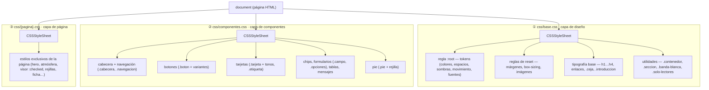

# Árbol CSSOM — Arrive Aruba Marketplace

> Entregable de la e-actividad 3.1 · construcción, cascada y herencia
> de los estilos del sitio.
> (realizado por Martin Alejandro Morfe Carballo)

## 1 · ¿Qué es el árbol CSSOM?

Al terminar de descargar el HTML, el navegador descarga las hojas de estilo
y construye el **CSSOM** (*CSS Object Model*): un árbol con todas las reglas
organizadas por **hoja → lista de reglas → selectores → declaraciones**.
Sobre ese árbol el motor aplica la **cascada** (origen y orden), la
**especificidad** y la **herencia** para calcular el estilo final de cada
nodo del DOM. DOM + CSSOM juntos producen el *render tree* que se pinta.

## 2 · Las hojas de estilo del proyecto

Cada página enlaza tres hojas, siempre en el mismo orden — base →
componentes → página — para que la cascada sea predecible:



## 3 · Cómo la cascada resuelve un elemento real

Para una tarjeta del catálogo (`article.tarjeta`), el motor consulta las
hojas en orden y va **sobrescribiendo** de lo general a lo particular:

```text
1. base.css        → todo elemento hereda de :root los tokens disponibles
2. componentes.css  → .tarjeta { background, border-radius, box-shadow,
                         transition, transform … }
3. componentes.css  → .tarjeta:hover { transform: translateY(-6px);
                         box-shadow: var(--sombra-hover) }   ← mayor
                         especificidad (clase + pseudo-clase), gana al
                         estado de reposo
4. {pagina}.css     → ajustes de rejilla: tamaño y posición del componente
```

**Herencia.** Las *custom properties* definidas en `:root` se heredan por
todo el árbol, por eso cualquier regla puede usar `var(--azul-zafiro)`
sin redeclararla. Las propiedades tipográficas (`font-family`,
`color`, `line-height`) también se heredan de padres a hijos, mientras
que `border`, `margin` o `background` **no** se heredan: cada
componente las declara a propósito.

**Especificidad (ejemplos del proyecto).**

| Selector | Especificidad | Uso |
|---|---|---|
| `:root` | (0,1,0) | declaración de tokens |
| `.tarjeta` | (0,1,0) | estado de reposo |
| `.tarjeta:hover` | (0,2,0) | interacción |
| `#visor-1:checked ~ .producto__vistas .producto__foto:nth-of-type(1)` | (1,4,0) | vista activa del visor del editorial |
| `.opciones__entrada:checked + .opciones__pastilla` | (0,3,0) | talla marcada |
| `.pie .pie__lista a` | (0,3,0) | enlaces del pie |

## 4 · Estado calculado y DevTools

El CSSOM no se muestra como árbol directo en el navegador, pero puede
observarse completo por elemento:

1. **F12** → pestaña **Elements**.
2. Panel **Styles**: reglas aplicadas *en orden de cascada*, con el origen
   (archivo y línea); lo tachado fue sobrescrito.
3. Panel **Computed**: el resultado final por propiedad — el estado que
   realmente se pinta, ya con herencia y `var()` resueltos.
4. En **Console**: `getComputedStyle(document.querySelector(".tarjeta")).color`
   devuelve el valor calculado de cualquier propiedad.

