# Árbol DOM del HTML — Arrive Aruba Marketplace

> Entregable de la e-actividad 3.1 · **`index.html`** como página modelo.
> (realizado por Martin Alejandro Morfe Carballo)

## 1 · ¿Qué es el árbol DOM?

Cuando el navegador lee el documento HTML, construye en memoria el **DOM**
(*Document Object Model*): una estructura de árbol donde cada etiqueta se
convierte en un **nodo**. El árbol DOM es el que JavaScript consulta y
modifica, y el que las herramientas de desarrollador muestran en la pestaña
*Elements*. La jerarquía padre–hijo del árbol define también el orden de
lectura de los lectores de pantalla, por eso la semántica importa.

## 2 · Árbol DOM de la página de inicio

```mermaid
graph TD
    D["document"] --> H["&lt;html lang=es&gt;"]
    H --> HD["&lt;head&gt;"]
    H --> BD["&lt;body&gt;"]

    HD --> MT["&lt;meta charset&gt;"]
    HD --> MV["&lt;meta viewport&gt;"]
    HD --> TI["&lt;title&gt;"]
    HD --> FV["&lt;link favicon SVG&gt;"]
    HD --> GF["&lt;link Google Fonts&gt;"]
    HD --> C1["&lt;link css/base.css&gt;"]
    HD --> C2["&lt;link css/componentes.css&gt;"]
    HD --> C3["&lt;link css/inicio.css&gt;"]

    BD --> S0["&lt;a.enlace-saltar&gt;"]
    BD --> HE["&lt;header.cabecera&gt;"]
    BD --> MA["&lt;main#contenido&gt;"]
    BD --> FO["&lt;footer.pie&gt;"]

    HE --> HB["&lt;div.cabecera__barra&gt;"]
    HB --> MK["&lt;a.marca&gt;"]
    MK --> MKS["&lt;svg.marca__estrella&gt;"]
    MK --> MKN["&lt;span.marca__nombre&gt;"]
    HB --> NV["&lt;nav aria-label&gt;"]
    NV --> UL["&lt;ul.navegacion__lista&gt;"]
    UL --> L1["&lt;li&gt; × 5 enlaces"]

    MA --> S1["&lt;section.hero&gt;"]
    S1 --> R1["&lt;div.hero__rejilla&gt;"]
    R1 --> T1["&lt;div.hero__texto&gt;"]
    T1 --> EY["&lt;p.ceja&gt;"]
    T1 --> H1["&lt;h1&gt; The island stays with you"]
    T1 --> IN["&lt;p.introduccion&gt;"]
    T1 --> AC["&lt;div.hero__acciones&gt; × 2 botones"]
    R1 --> FG["&lt;figure.hero__ventana aria-hidden&gt;"]
    FG --> VE["&lt;div.ventana&gt; (fotografía de Aruba + sol, mezcladas con CSS)"]

    MA --> S1B["&lt;section.pelicula&gt; Atmósfera de la isla"]
    S1B --> IF["&lt;img.pelicula__foto&gt; (Ken Burns en CSS)"]
    S1B --> VL["&lt;div.pelicula__velo&gt;"]
    S1B --> LM["&lt;p.pelicula__lema&gt;"]

    MA --> S2["&lt;section&gt; Prendas destacadas"]
    S2 --> RP["&lt;div.rejilla-productos&gt;"]
    RP --> TJ["&lt;article.tarjeta&gt; × 4"]
    TJ --> TA["&lt;a.tarjeta__enlace&gt; → &lt;figure&gt; + SVG"]
    TJ --> TC["&lt;div.tarjeta__cuerpo&gt; (categoría, h3, precio)"]

    MA --> S3["&lt;section.banda-blanca&gt; Categorías"]
    S3 --> RC["&lt;ul.rejilla-categorias&gt; → &lt;li&gt; × 4 → &lt;a.azulejo&gt;"]

    MA --> S4["&lt;section&gt; Materialidad"]
    S4 --> PS["&lt;ol.pasos&gt; → &lt;li.paso&gt; × 3"]

    MA --> S5["&lt;section.banda-blanca&gt; Testimonios"]
    S5 --> TS["&lt;div.rejilla-testimonios&gt; → &lt;figure.testimonio&gt; × 2"]

    MA --> S6["&lt;section.llamado&gt; Llamado a reservar"]
    S6 --> LC["&lt;div.llamado__caja&gt; + &lt;a.boton--claro&gt;"]

    FO --> FR["&lt;div.pie__rejilla&gt; → 3 columnas (marca, explorar, atención)"]
    FO --> LG["&lt;p.pie__legal&gt;"]
```



*El árbol completo de `index.html` tiene ~182 nodos; el diagrama resume
la jerarquía funcional y la profundidad media del documento.*

## 3 · Esqueleto común a las seis páginas

Todas las páginas del sitio comparten el mismo armazón, lo que garantiza
navegación y estilos consistentes:

```text
body
├── a.enlace-saltar          (accesibilidad: saltar al contenido)
├── header.cabecera          (marca + navegación principal)
├── main#contenido           (contenido propio de cada página)
│   └── … secciones específicas …
└── footer.pie               (enlaces, contacto y legal)
```

Las páginas que agregan comportamiento cargan sus scripts al final del
`body`, después del contenido visible:

```text
body → … → script js/bd.js → script js/{pagina}.js
```

## 4 · Cómo inspeccionar el árbol DOM real

1. Abre cualquiera de las páginas en el navegador.
2. Presiona **F12** (o clic derecho → *Inspeccionar*).
3. La pestaña **Elements** (Chrome/Edge) o **Inspector** (Firefox) muestra
   el árbol DOM en vivo: cada nodo se puede desplegar, editar temporalmente
   y localizar desde el elemento visible (clic derecho → *Inspect*).
4. En **Console**, `document.querySelector("main")` devuelve el nodo
   raíz del contenido; `\$0` es el nodo seleccionado en el panel.

